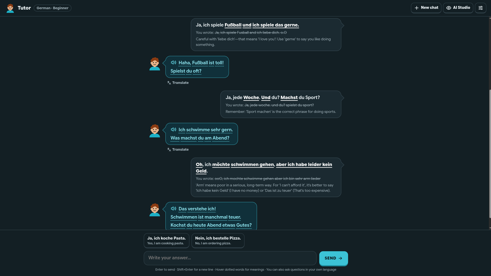

# Studio Tutor

A Chrome extension that turns **Google AI Studio, ChatGPT or DeepSeek** into a chat-style language tutor. You role-play everyday scenes with a character, write (or speak) in the language you're learning, and get corrected as you go.



## Features

- **Corrections inline.** The tutor rewrites your message. Fixed words are **bold and underlined**; hover one to see what you wrote and why it was wrong. Your original is shown underneath, struck through.
- **Correction strictness.** *Relaxed* fixes only mistakes that change the meaning. *Normal* fixes grammar, spelling, accents and wrong words. *Strict* fixes everything, including punctuation and phrasing a native speaker wouldn't use. You can change it mid-chat.
- **Don't know a word? Type it in your own language.** For example, "Ich spiele Fußball *and* ich schwimme". The English word isn't counted as a mistake. It's swapped for the German one, highlighted as a **new word** (`and → und`), and listed under your message.
- **Hover translations.** Every word in the tutor's reply has a dotted underline. Hover it for the meaning (plus a romanized reading for scripts like Japanese, Russian or Arabic). Click a word or the speaker icon to hear it, and use **Translate** to see the whole reply in your language.
- **Speaking practice.** Click the microphone and answer out loud. Your speech is typed into the box in the language you're learning, so you can check it before sending (or turn on auto-send in Settings).
- **Accented-letter keys.** A row of buttons for the letters your keyboard is missing (ä ö ü ß, é è ç, ñ ¿ ¡…). Use the ⇧ key, or hold Shift while clicking, for capitals.
- **Ready-made scenes.** Café, hotel, directions, new friend, market, restaurant, doctor, clothes shopping, job interview, free talk. You can also describe your own scene.
- **Any language pair and level.** Pick the language you're learning, the language you speak, and Beginner / Intermediate / Advanced.
- **Suggestions** for what to say next, and **tutor notes** when you ask a grammar question in your own language.

## Install

1. Open `chrome://extensions` and turn on **Developer mode** (top right).
2. Click **Load unpacked** and choose this folder.
3. Open one of the supported sites while signed in:
   - https://aistudio.google.com
   - https://chatgpt.com
   - https://chat.deepseek.com

   The tutor opens on top of the page. The extension's toolbar button shows or hides it.

## Two ways to run it

Choose in **Settings** (the sliders button).

**Use the chat on this page (default, no key).** The tutor types into the site's own chat box behind the overlay and reads the answer back. Each new scene starts a fresh chat on that site. Click the site's name in the header (e.g. **AI Studio**, **ChatGPT**) to see the real page, for example to pick a model or check for an error. This depends on the site's layout, so a site redesign can break it until the selectors in `content/driver.js` are updated.

**Use an API key.** Calls the API directly, which is faster and doesn't depend on any page layout. Choose a provider:

| Provider | Get a key | Default model |
| --- | --- | --- |
| Gemini (free tier) | aistudio.google.com/apikey | `gemini-flash-latest` |
| OpenAI | platform.openai.com/api-keys | `gpt-4.1-mini` |
| DeepSeek | platform.deepseek.com/api_keys | `deepseek-chat` |

You can type any other model name in Settings. Keys are stored only in this browser (`chrome.storage.local`).

## Notes

- Speech recognition uses Chrome's built-in service, which needs an internet connection. The first time, Chrome asks for microphone access for the site you're on.
- Each site keeps its own conversation, so a chat on ChatGPT and one on AI Studio don't mix.
- Changing the mode or API provider takes effect on your next new chat.

## How it works

The tutor tells the model (`content/prompt.js`) to answer every turn with one JSON object:

- `correction`: your message corrected, with one entry per change: the original text, a reason, and whether it was a `mistake` or a `new_word`
- `aside`: an answer to a question you asked about the language
- `reply`: the character's sentences, each with a translation and `[word, meaning(, reading)]` pairs
- `suggestions`: 2–3 things you could say next

Each message you send ends with a tag like `[corrections: strict]`. That's why changing strictness works mid-chat, even on a website chat where the instructions can't be edited after they're sent.

`content/ui.js` turns the JSON into chat bubbles. Words and fixes are matched back into the sentence text, so if the model copies a word slightly wrong, that word just isn't underlined; nothing breaks.

## Files

```
manifest.json
background.js        toolbar button + Gemini / OpenAI / DeepSeek API calls
content/data.js      languages, accent keys, levels, strictness, scenes
content/prompt.js    tutor prompt + JSON parser
content/driver.js    site drivers (AI Studio, ChatGPT, DeepSeek) and the API driver
content/ui.js        overlay UI (shadow DOM)
content/tutor.css    styles (light + dark)
assets/image1.png    screenshot
```
